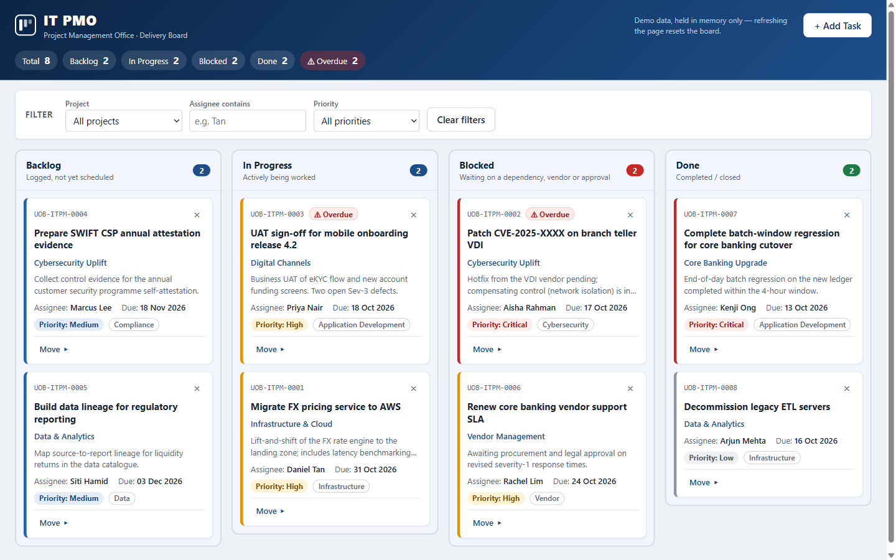

# IT PMO Kanban

An internal demo and training Kanban board for the IT Project Management Office of a fictitious bank. It tracks IT delivery work across Backlog, In Progress, Blocked and Done, and fits in one `index.html` file with no dependencies. It uses no real bank's logo, trademarks or styling.



**Live demo:** https://selangchezhiyan.github.io/it-pmo-kanban/


[](https://github.com/selangchezhiyan/it-pmo-kanban/actions/workflows/pages.yml)

## Features

- Four columns (Backlog, In Progress, Blocked, Done) with count badges, plus a header summary of totals and overdue tasks.
- Move cards by native drag and drop or with each card's keyboard-friendly **Move ▸** menu.
- Filter by project, assignee and priority. The column badges show `shown / total` while a filter is on.
- Overdue tasks (due date before today and not Done) are flagged on the card.
- **Add Task** modal with inline validation and length limits. New cards get IDs like `UOB-ITPM-0009`.
- Inline "Delete? Yes / No" confirmation and toasts, with no browser pop-ups.
- Optional email notification for each new task via [FormSubmit](https://formsubmit.co/).
- Keyboard accessible: focus is kept after changes, and Escape closes menus and the dialog.

## How to install

```bash
git clone https://github.com/selangchezhiyan/it-pmo-kanban.git
```

There is no build step, npm or anything else to install.

## How to run

- Double-click `index.html`. It works straight from `file://`.
- Or serve the folder, e.g. `python -m http.server 8000`, and open http://localhost:8000.
- Or use the [live demo](https://selangchezhiyan.github.io/it-pmo-kanban/).

## Configuration

New-task emails go through FormSubmit. Set the address once, in the `FORMSUBMIT_ENDPOINT` constant at the top of the `<script>` block. FormSubmit needs a one-time activation: the first submission sends a confirmation email to that address, and nothing is delivered until you click the link in it. If the request fails, the card is still added and a warning toast says "Card added locally — email notification failed".

## Notes

- **No persistence, on purpose:** the board lives in memory, and refreshing the page resets it to the seed data. The seed due dates are relative to today, so the demo always shows some overdue tasks.
- The only network call is the FormSubmit request. The app loads no CDN scripts, web fonts, analytics or external images.

## Deployment / CI

`.github/workflows/pages.yml` runs on every push to `main` (or manually). It copies only `index.html` (plus `.nojekyll`) into the site and deploys it to GitHub Pages, so repo files like `CLAUDE.md` and `docs/` are not published.

## Project structure

```
index.html                    the whole app (markup, styles, script)
docs/screenshot.png           README screenshot
.github/workflows/pages.yml   GitHub Pages deployment
CLAUDE.md                     guidance for Claude Code
.claude/commands/             the /publish-github command
```
